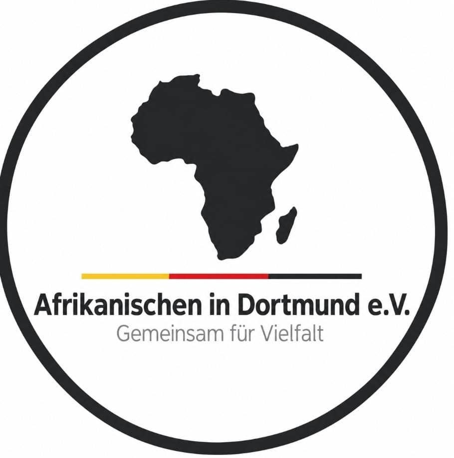

<div align="center">
  
  <h1>Afrikanischen in Dortmund e.V.</h1>
  <p><strong>A community website built to present the association, its work, and its activities in Dortmund.</strong></p>
</div>

---

## About the project

This website was developed as a web project to introduce Afrikanischen in Dortmund e.V. and make information about the association and its community activities easier to find. The site is in German and includes responsive pages, imagery, and client-side navigation.

## Built with

- React
- TypeScript
- Vite
- React Router
- i18next

## Run locally

Install dependencies and start the development server:

```bash
npm install
npm run dev
```

Vite will print the local development URL in the terminal.

## Production build

Create an optimized static build:

```bash
npm run build
```

The deployable website is generated in `dist/`. Preview the production build locally with:

```bash
npm run preview
```

## Hosting on LWS

Upload the **contents** of `dist/` to the website's document root in the LWS hosting panel. The build includes the Apache `.htaccess` file for React Router routes, caching, and basic security headers.

## Project structure

```text
public/       Static images, icons, and Apache hosting rules
src/          React application source
dist/         Production build output (created by npm run build)
```
